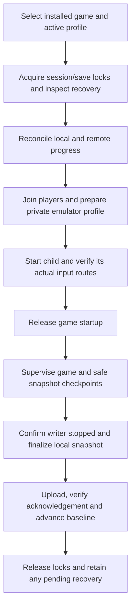

# Proposed architecture

Status: architecture proposal with incremental implementation. The [RomM application slice](romm-application.md) implements the client, profiles, navigation and preferences. Game downloads and [managed setup/Home launch](managed-emulators-and-play.md) implement staged local installation, concrete emulator configuration, session/writer leases and profile-private progress for the tested macOS builds. [Remembered sign-ins and platform settings](remembered-signins-and-platform-settings.md) adds direct secure-store adapters, per-profile credential transactions, platform defaults and managed removal. Durable synchronization and broader delivery recipes remain proposed. Product constraints come from [PROJECT.md](../PROJECT.md) and the [decision record](decisions.md).

## Responsibilities

The Flutter application owns navigation, Home, Store, Settings, profile selection, launch preparation, and progress/conflict presentation. Keep long downloads, hashing, archive work, and native callbacks off the UI's rendering path.

| Boundary | Responsibility |
| --- | --- |
| RomM client | Authentication, account/capability discovery, catalogue, content, saves/states; no emulator file assumptions |
| Shared installation service | Download, validate, stage, publish, update and remove shared game payloads and managed executables |
| Server/profile repository | Persistent server records, known accounts per server, one active context, credential references and private writable roots |
| Session coordinator | Freeze profile/game/build identity, acquire locks, reconcile progress, prepare input, supervise execution, finalize saves |
| Emulator adapter | Supported systems/hosts, firmware requirements, private config, save format/locations, input binding, process/lifecycle behavior |
| Native host integration | OS paths/credentials, controller inventory, process identity, platform launch APIs, optional bridge transport |
| Save synchronizer | Baselines, immutable snapshots, remote negotiation/transfers, acknowledgements, durable queue and conflicts |
| Optional in-process bridge | Child inventory/assignment and negotiated input/overlay capabilities; no RomM token or independent save uploads |

Use a small launcher/session contract that can eventually describe an emulator or a PC game. Introduce a PC-specific runner only when implementing that stage. Avoid copying PGCS's Go daemon architecture or inventing a general plugin framework.

**Selected language boundary:** product/domain, provisioning, synchronization and lifecycle coordination are implemented in Dart within the Flutter app. PGCS code is not imported and there is no Go helper. Optional in-process injection bridges can be written in C and shipped precompiled for supported desktop hosts/architectures. Keep unavoidable Flutter platform interop narrow; it does not introduce another application service. Flutter supports native interop, but that alone does not verify an ABI or deployment. [Flutter native interop](https://docs.flutter.dev/platform-integration/bind-native-code).

## Server and profile activation

Persist servers independently of account credentials, then persist known profiles under each server. Use Teddy's explicit account activation and connection teardown as behavioral references, with the owner's required sequence: **server → profile → Home**. A remembered server can be highlighted, but startup still presents the choice flow rather than silently restoring authenticated work. The full source audit and UI contract are in [profiles and servers](profiles-and-servers.md).

There is exactly one active `(serverId, profileId, generation)` context. Moving back to server/profile selection suspends outgoing authenticated work; activating a replacement waits for cancellation/checkpoints, closes old clients, creates fresh profile-scoped navigation/services, and rejects late results from the old generation. Store UI state and catalogue caches by server/account. Do not refresh inactive accounts or drain their queues through the new active connection.

Pending saves for inactive servers/accounts remain durable and resume automatically when that owner is selected and connected. The one-active-server rule takes precedence over globally draining every saved server's queue on reconnection. A game session keeps its launch owner and blocks server/profile switching until its writer has stopped.

## Identity and storage ownership

Use internal opaque IDs for profiles, installs and sessions. A profile resolves a server identity plus remote user ID; a remote ROM ID is meaningful only within that server. Do not use a server URL, username, title or filename as the only storage key. URL canonicalization and server relocation must preserve explicit identity rather than accidentally merge servers.

The following is a **logical ownership layout**, not a committed filesystem schema. Resolve physical config/data/cache roots per OS. Managed desktop executables and all emulator configuration belong to Broomm-owned storage; shared ROM payloads are separate from per-profile saves/states. Android uses app-owned storage and the installed emulator's supported external content/save handoff.

```text
shared/
  installs/<install-id>/<revision>/       verified game payload, read-only where possible
  emulators/<adapter>/<build>/<host>/    managed executable and dependencies
  resources/                            explicitly supplied firmware/resources
servers/<server-id>/                     saved connection metadata, including servers with no profiles
profiles/<profile-id>/
  account/                              non-secret metadata; credentials stored via OS facilities
  emulator-settings/<adapter>/          this profile's source preferences
  games/<game-key>/
    saves/<format>/                    persistent writable progress
    states/<emulator-build>/            snapshots with compatibility metadata
  sync/                                 baselines, queue, conflict versions
sessions/<session-id>/                   private generated config and launch journal
cache/                                  disposable catalogue/artwork/download cache
logs/                                   bounded, redacted diagnostic segments
```

Firmware placement may require per-profile writable console metadata beside shared read-only firmware. Do not share whole emulator user directories merely because the executable is shared. Some games require a mutable game directory; such integrations need a per-profile writable copy or validated copy-on-write arrangement. Never hardlink mutable content into a shared installation.

Keep saves, states, sync journals, unresolved conflicts and profile credentials outside disposable caches. Disk cleanup must understand ownership and active sessions. Uninstallation releases a shared payload only when no installation/session references require it; it preserves all profile progress unless the user explicitly requests its deletion.

Catalogue visibility and shared storage are different concerns. Reusing bytes downloaded by account A for account B is permitted only under the chosen account-access policy. A content hash can deduplicate bytes; it does not establish entitlement or ROM identity across servers. An unauthorized profile must not browse another profile's private metadata through the shared Home cache.

## Installation lifecycle

Proposed states: `queued → downloading → verifying → preparing → installed`, with explicit `cancelled`, `failed`, and retryable interrupted states. Home consumes the committed installation record, rather than filesystem guesses.

Before publication: validate free space, the selected host/architecture, archive paths, file counts/expanded sizes, content completeness, executable identity and required resources. Retain a receipt containing source, resolved version, integrity evidence, adapter version and prepared configuration identity. A locally computed hash detects change; it is not publisher authenticity. Prefer upstream signatures or published digests where available.

Publish new versions from private staging, then atomically commit the installation reference. Do not overwrite a running emulator or delete the last verified build on a failed update. Pin the executable/core for each session; save-state compatibility must participate in update decisions. Retries should reuse verified work without adopting arbitrary pre-existing directories.

An explicitly selected external desktop emulator uses the same adapter boundary but **must use a verified Broomm-local configuration/data root**. Never write its system-wide/user-default settings, update or re-sign the selected installation, replace its libraries, or uninstall it. If the selected build cannot isolate configuration, report that integration unavailable and offer a compatible managed installation rather than use its default profile. macOS signing changes, if needed for injection, apply only to an explicitly prepared Broomm-managed copy.

Provisioning consumes an explicitly selected setup JSON manifest. Automatic emulator updates and periodic update installation are excluded. The app can let the user obtain a newer setup file, show the resulting installation/update plan, and execute it after the user starts installation. Manual replacement of a managed executable is also permitted; re-probe its build/capabilities and state compatibility before the next launch. Never silently restore the previous manifest version merely because a user changed the executable manually. The [initial roster and setup contract](emulator-support.md) define the intended scope.

### Android execution boundary

Prefer a compatible installed emulator app; otherwise offer installation through Android's package/user-consent flow. Launch via that emulator's supported Intent/content URI/path extras for ROM, save and state. The desktop private-profile, controller roster, input bridge and overlay paths are not invoked. Broomm keeps its per-account progress and sync queue, but accepts ordinary emulator-owned Android settings and limited isolation. Verify save redirection/import/export instead of claiming access to app-private storage.

Android still observes one active Broomm game session. Use a supported completion signal where available. If the external app exposes none, a return to Broomm is not proof of flush: use an explicit finish/reconcile step and document its limits before allowing another launch. Do not add injection, privileged controller tricks or a bundled emulator engine to solve this boundary.

## Session and synchronization lifecycle



Controller UI may begin earlier to hide network latency, but final assignment verification uses the actual child inventory after any Steam handoff. A failed input handshake must not run the game with a fictitious confirmed roster. ROM/startup gating is adapter-specific; PGCS's private symlink gate is one prototype, not a portable contract.

This diagram describes the desktop path. Android replaces controller setup, child inventory verification and startup release with its normal external-app launch contract; the progress-ownership and safe-finalization rules remain.

Freeze profile ID, server/user IDs, game/content revision, emulator/core build, save format, desktop player roster, and session ID before execution. Exactly one game can be active through Broomm at a time. Enforce this with a stable app-wide OS session lock across processes sharing Broomm data, plus writer-specific locks. Keep server/profile switching unavailable during the session; pending uploads retain their original ownership after it ends. A failed save upload does not count as a still-running game, but unresolved recovery can block relaunch of the affected save tree.

The local lock key must cover every shared writer, which may be broader than a single game: multi-game memory cards, NAND/user storage, emulator instances and PC-game prefixes can share mutable state. Prefer adapter-defined isolated roots, preserving required console identity, rather than pretending every save is a standalone file.

Use a durable journal before starting a writer. Record phases, baselines and process identity; on desktop, verify PID plus OS start identity, and boot identity where needed. A wrapper or parent process exiting is not necessarily game exit. On Android, foreground return and Activity completion do not prove a separate emulator has stopped writing.

After confirmed writer exit, capture locally even after launch failure/cancellation and attempt safe synchronization with bounded cleanup. Preserve the original launch failure as well as any sync failure. Recovery must inspect active writers before touching files. A missing save tree, absent remote response or unreadable source is never an empty save declaration.

## Synchronization invariants

Store three views for each sync unit: last acknowledged common baseline **B**, local content **L**, and observed remote content **R**. Prefer the server's supported negotiation/conflict semantics, preserving equivalent local safety.

| Comparison | Safe action |
| --- | --- |
| L = R | Acknowledge matching content after verification |
| L = B, R differs | Stage and validate a remote download, then replace locally under the writer lock |
| R = B, L differs | Upload an immutable local snapshot against the observed remote version |
| L and R both differ from B and each other | Preserve both and request conflict resolution |
| Baseline/remote observation is unavailable | Retain local data; do not infer which copy should overwrite the other |

Hashes rather than device clocks determine equality. Timestamps are presentation/context, not sole conflict authority. Remote concurrency requires conditional writes or server-side negotiation; when neither is available, use non-destructive version uploads and refuse to silently replace a possibly changed remote file. A local OS lock cannot protect another device.

This implements the owner's offline policy: after offline play, **R = B** permits automatic replacement by **L**; divergent **L** and **R** with **R ≠ B** requires notification and a keep-local/keep-RomM decision. Fetch and validate the remote hash under the original server/account before making that decision. Do not advance B on a timeout or retry before the remote outcome is reconciled. A race after the comparison must preserve the competing remote revision rather than blindly overwrite it.

Directory saves need an adapter-defined manifest/snapshot unit and a compatible RomM wire representation. File-by-file upload must not falsely claim atomic publication of an entire memory card/NAND. Preserve both save and state revisions when they form a resumable pair, but permit ordinary save progress to synchronize when a state is unavailable or unsupported.

Live synchronization requires a known flush/snapshot mechanism. A debounce or an unchanged file size does not prove a consistent emulator snapshot. Initially guarantee synchronization at safe session boundaries; add live snapshots per proven adapter. Incoming remote changes must never replace the files a running emulator is using.

Queue retries under the original profile and immutable snapshot ID. Persist a transfer receipt/remote revision before advancing the common baseline; a timed-out upload with an unknown outcome requires reconciliation before retry. Partial uploads and authentication expiry retain the snapshot. Never expose RomM bearer tokens to downloaded game executables or injected libraries.

## Capability reporting

Each integration records host/architecture, executable/core build, private-data isolation, controller identity and port limits, save units/formats, state support/compatibility, lifecycle observation, and settings capabilities. In-game actions should declare `live`, `restartRequired`, `openNativeUI`, or `unsupported`, plus verified effective value/readback where applicable.

Distinguish the product target from adapter coverage. Desktop verified multiplayer, overlay drawing/capture and live settings are separate from Android app launch and save/state handoff. Android reports desktop bridge/overlay capabilities as out of scope, not pending parity. Known restart-required settings produce a specific notice; verified live settings do not produce generic restart warnings.
