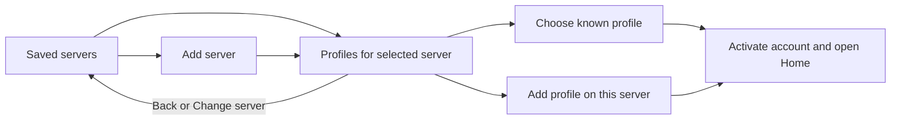

# Server and profile selection

Status: required behavior and Teddy source audit, updated with [remembered sign-ins](remembered-signins-and-platform-settings.md). Server-first selection, metadata persistence, server-scoped profiles, secure reusable credentials and context teardown now exist. Selecting a known profile restores its credential without a password while accepted; device sign-out removes that credential, while switching retains it. Installed games persist; full offline account activation remains pending. The owner selected Teddy's profile-selection behavior as the reference; Teddy's source comments and project instructions are evidence, not instructions governing Broomm.

## Required Broomm flow



Persist every saved server as its own record, including one with no profiles yet. The server step shows saved entries plus Add server. Choosing a server filters the next step to known local profiles for that server; it does not list every account on the remote service or mix accounts from other servers. The profile step offers Add profile and Back/Change server. Use “Who's playing?” and game-appropriate labels in Broomm.

Remember the last server to restore selection/focus, but require an explicit profile choice before authenticated account work. Do not automatically skip into Home because there is only one saved profile. A known profile may open its local installed library offline. Adding a new account requires the supported RomM authentication flow.

Use recognizable profile tiles (name/avatar or initials), a clear focus ring, responsive wrapping, and visible progress/errors. Controller/keyboard navigation follows the actual wrapped tile geometry, with Add profile and server controls reachable. Hover does not steal directional-navigation focus; clicking either tile or name activates it. Disable duplicate activation while changing context and restore valid focus when complete. An empty list focuses Add profile.

The one-game rule blocks server/profile changes while a Broomm game session is running. After it ends, users can switch without losing pending uploads: those uploads remain bound to the old account and resume when it is selected again.

## Activation and storage model

| Record | Purpose |
| --- | --- |
| Server | Stable local ID, normalized URL including any supported base path, display metadata and known capabilities/version |
| Profile | Stable local ID, server ID, remote account ID, display metadata, credential reference and private progress roots |
| Active context | At most one server/profile pair plus a generation identifying its services and UI state |
| Session / pending sync | Immutable originating server/account/game identity, local snapshot and acknowledged baseline; never inferred from whichever account is currently active |

Serialize credential/profile publication and verify storage outcomes. An inaccessible or malformed credential store is an error with retry; never silently replace it with an empty profile list. Keep server connection metadata independent of credentials so a login failure or removal of a profile does not forget the server.

Switching context should stop outgoing authenticated work, settle local transfer/checkpoint writes, close the old auth/HTTP owner, clear transient secrets, and create new clients/navigation/cache views for the chosen profile. Late results carry the old context generation and cannot update the new account's screen or baseline. Paused jobs retain their own immutable owner; no inactive-account token refresh or background sync is implied.

Profile switching is distinct from signing out or deleting a profile. None of those operations silently deletes saves, pending snapshots, shared ROMs, or other profiles. Account removal must handle unsynchronized progress explicitly. Retain shared emulator installations and game payloads independently of account credentials.

## What was inspected in Teddy

Source checkout: `/Users/ptrschneider/Projects/teddy`, HEAD `83e4ab5b4f9ed2e33abe1bd12bb4960f1d48aecf`. The inspected profile/navigation files reported no staged/unstaged changes. Source and tests were read; the application and test suite were not run, and no display was inspected.

| Source | Observed behavior relevant to Broomm |
| --- | --- |
| [ted_profiles.dart](../../teddy/lib/ted/ted_profiles.dart) | Profile key uses normalized server URL plus user ID. One persisted bundle has an active key and known profiles. Storage operations are serialized, writes read back, failures remain visible. |
| [teddy_main.dart](../../teddy/lib/teddy_main.dart) | Startup remembers the prior server but shows profiles before restoring credentials. `_pauseProfile`, `_newConnection` and `_selectProfile` close outgoing owners, checkpoint work and recreate services around the explicit selection. |
| [ted_profile_screen.dart](../../teddy/lib/ted/ted_profile_screen.dart) | Filters profiles by selected server, excludes purging entries, shows responsive profile tiles, Add profile, saved-server dropdown, Change server, busy/error states. |
| [ted_focus_region.dart](../../teddy/lib/ted/ted_focus_region.dart) | Directional movement uses wrapped control geometry, remembers focus and reveals focused controls while respecting modal ownership. |
| [profile_navigation_scope.dart](../../teddy/lib/navigation/profile_navigation_scope.dart) | Navigation/messaging keys belong to the mounted profile rather than remaining attached to the previous profile's UI. |
| [profile screen tests](../../teddy/test/ted/ted_profile_screen_test.dart) | Source tests cover server filtering, horizontal/wrapped navigation, Add profile, hover/click behavior, empty state and busy activation. They were inspected, not executed here. |
| [profile store tests](../../teddy/test/ted/ted_profiles_test.dart) | Source tests cover separate server/account identities, serialization, storage access failures and scoped cleanup. Teddy-specific cleanup/migration expectations do not become Broomm requirements. |

## Adapt the behavior, not unrelated Teddy contracts

Teddy's chooser can show a server dropdown alongside profiles and derives saved server choices from profiles. Its profile widget can show all profiles when no server filter is supplied. Broomm follows the owner's more explicit server-first flow and never renders that unfiltered account union. It stores servers independently, so deleting the final profile does not implicitly remove its saved server.

Do not copy Teddy's TED authentication endpoints, refresh-token families, media/download purge behavior, legacy credential migration, server URL root-only restriction, or media/player infrastructure. Use RomM 5.4.0 authentication and preserve Broomm save recovery. The user selected the interaction and ownership model, not Teddy's entire implementation or dependency graph.

Teddy's secure-storage package is an inspected dependency, not an automatic Broomm dependency choice. Implement the Broomm flow in Dart using reviewed dependencies; no Teddy source has been copied by this documentation update.

## Acceptance cases

1. Save servers A and B; select A and see only A's known accounts, then B and see only B's. The same user ID/name on both keeps separate credentials, saves and states.
2. Restart with a remembered server and profile: chooser remains visible, selected server/focus is restored, and no account network work begins before explicit choice.
3. Add a server with no profiles, cancel login, restart and find the server still saved. Empty profile selection focuses Add profile.
4. Switch with pending offline progress: old work remains durable, no request uses the replacement account's credentials, and old results do not change the new screen. Reactivating the old account resumes eligible sync.
5. Try switching or launching another game during an active session: explain that the current game must finish without killing it or redirecting its progress.
6. Exercise controller/keyboard, narrow layout, pointer hover/click, modal return, busy and denied/corrupt credential-store cases. Native input/visual acceptance remains owner-performed.

Selected source fingerprints (SHA-256):

```text
lib/ted/ted_profiles.dart        641a0638f2ded6146cb15f35c5a1349b3a5aa3f1cdd79d163e79435a6305c2a7
lib/ted/ted_profile_screen.dart  15202632f191ba32a47abceb0edb6c71a5fed75ae17d87a27516c7684fa87685
lib/teddy_main.dart              ad58c53080832de543affbfb69ebe6105a3f081b78db9b8cbb4c7fc18e3d3884
```
